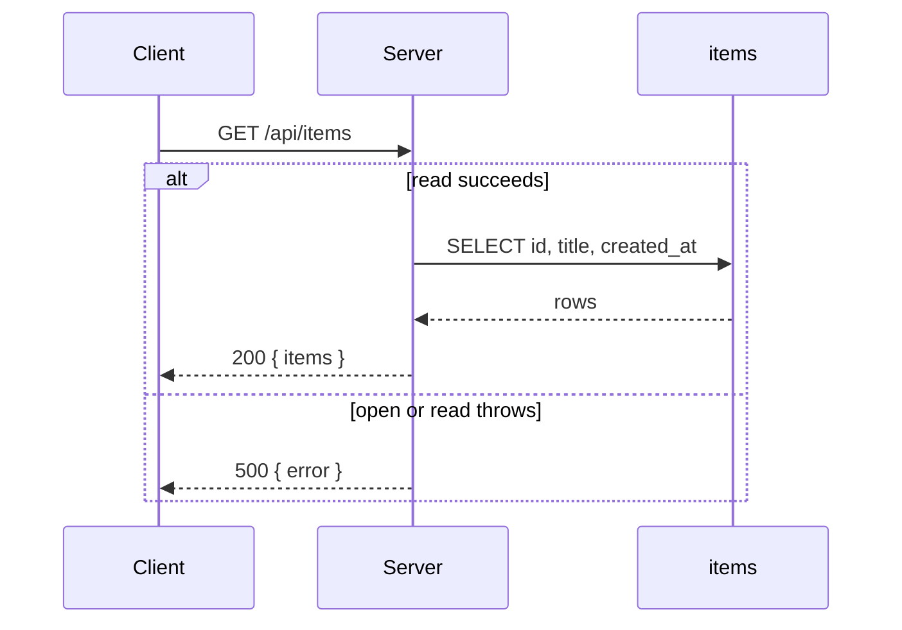
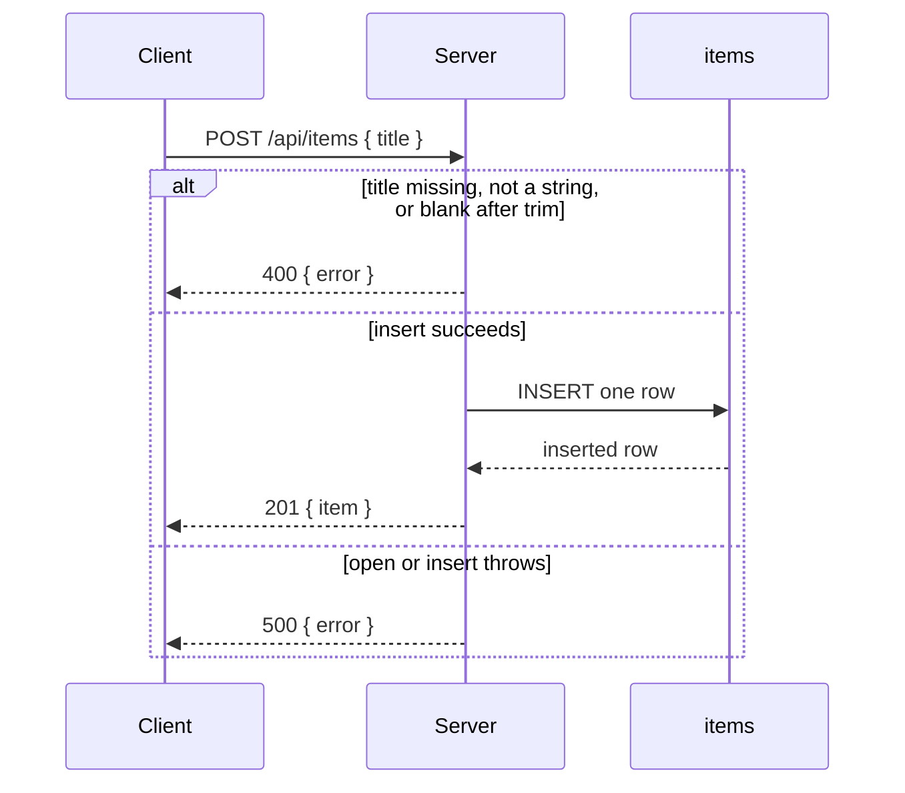
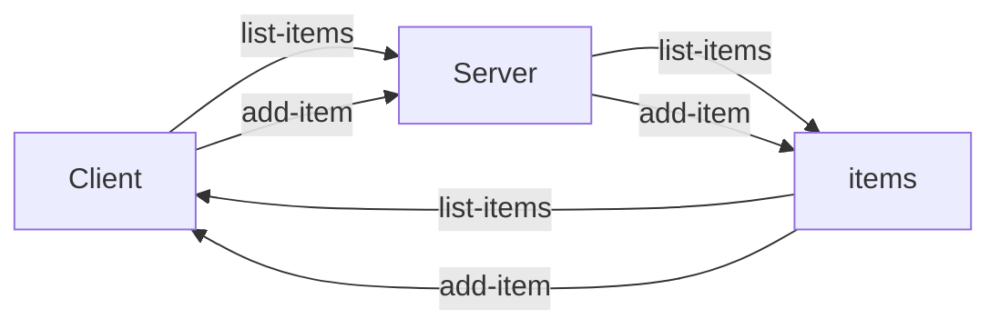

# Architecture

## Assumptions

Choices made because the request said to pick.

- SQLite access library is `better-sqlite3`. The Next.js route handlers run on the Node.js runtime, because that library is a native addon.
- Test runner is Vitest. The dev command is `npm run dev` (`next dev`). The test command is `npm test` (`vitest run`). The package manager is npm.
- The database file is `data/items.sqlite`. The first request creates the file and the `items` table when either is missing.
- `id` is an integer primary key assigned by SQLite. `title` is text. `created_at` is text, ISO-8601 UTC, set by the server at insert. The client sends neither `id` nor `created_at`.
- The handler trims `title` and rejects a missing, non-string, or empty-after-trim value. There is no maximum length.
- `GET /api/items` returns every row, ordered by `created_at` ascending, then `id` ascending. There is no pagination.
- The Items screen is `/`. A successful add returns `201` and the screen appends that item. It does not send another GET.
- Error bodies are `{ error: string }`. An empty table is `200` with `{ items: [] }`.
- The list shows each item's title. A failed add leaves the typed title in the field and leaves the list unchanged.

## Problem and non-goals

This is a local workshop shell: one full-stack app a person opens in the browser. The Items screen shows a list of items and a form that adds one item. The list is the pattern later features will copy.

The shell does not include accounts, auth, deploy, a hosted database, extra screens, search, edit, delete, or any feature an audience has not asked for. It has two operations: load the items, and add one item.

## Stack

- Client: Next.js App Router, React, TypeScript, Tailwind CSS.
- Server: Next.js route handlers on the Node.js runtime.
- Database: one local SQLite file, `data/items.sqlite`, accessed with `better-sqlite3`. No Postgres.
- Dev command: `npm run dev`.
- Test command: `npm test`.

## Runtime

The person uses a browser on the same machine as the Next.js server. The server reads and writes the local SQLite file. There is no third party. The system map below is the flowchart for `list-items` and `add-item`.

## Route traces

### list-items

caller: Items screen, when it opens
request: `GET /api/items`. No query and no body.
handler: In order: open `data/items.sqlite`, creating the file and the `items` table when either is missing; read every row from `items` ordered by `created_at` ascending, then `id` ascending; return `200`. If open or read throws, return `500` and do not invent rows.
stages: Client, Server, items
response: `200` with `{ items: Array<{ id: number, title: string, created_at: string }> }`. An empty table returns `{ items: [] }`. Failure returns `500` with `{ error: string }`.
screen: On `200` with rows, the list shows each title in that order. On `200` with an empty array, the list shows the empty state. On `500` or a failed request, the list shows the load error. The form stays usable in every case.
diagram:



### add-item

caller: Items screen, the add action on the form
request: `POST /api/items`. JSON body `{ title: string }`.
handler: In order: parse the JSON body; if the body is not JSON or `title` is not a string, return `400`; trim `title`; if the trimmed value is empty, return `400`; open `data/items.sqlite`, creating the file and the `items` table when either is missing; insert one row with the trimmed title and a server-set `created_at`; return `201` and the inserted row. A `400` does not insert. If open or insert throws, return `500`.
stages: Client, Server, items
response: `201` with `{ item: { id: number, title: string, created_at: string } }`. A blank or invalid title returns `400` with `{ error: string }`. A failed save returns `500` with `{ error: string }`.
screen: On `201`, the list appends the returned item and the title field is cleared. On `400`, the form shows the blank-title state, the typed title stays, and the list does not change. On `500` or a failed request, the form shows the save error, the typed title stays, and the list does not change. This operation has no empty response.
diagram:



## System map



## Journeys

### Open the screen and load the items

Uses `list-items`.

1. Screen: Items at `/`. It has a list region and a form with a title field and an add action. Opening the screen starts the load.
2. Request: `GET /api/items`. No body. Route trace `list-items`.
3. Handler: open the SQLite file, then read every `items` row in `created_at`, `id` order. There is no request to validate.
4. Tables: read `items`. The invariant is that `title` is required and non-empty. An empty table is valid. Stage: `items`.
5. Response: `200` and `{ items: Array<{ id: number, title: string, created_at: string }> }`. An empty table returns `{ items: [] }`. A failed read returns `500` and `{ error: string }`.
6. Screen: rows render as titles in response order. An empty array shows the empty list. `500` or a failed request shows the load error.

### Submit the form to add an item

Uses `add-item`.

1. Screen: the title field and the add action on Items.
2. Request: `POST /api/items` with `{ title: string }`. Route trace `add-item`.
3. Handler: reject a missing, non-string, or blank-after-trim title before any insert. Otherwise insert one row. The server sets `created_at`.
4. Tables: insert one row into `items`. The invariant is that `title` is required and non-empty. Stage: `items`.
5. Response: `201` and `{ item: { id: number, title: string, created_at: string } }`. A blank title returns `400` and `{ error: string }`. A failed insert returns `500` and `{ error: string }`.
6. Screen: `201` appends the item and clears the title field. `400` shows the blank-title state. `500` or a failed request shows the save error. Both errors keep the typed title and leave the list unchanged.

## Data model

One table, `items`. No relations.

| column | type | rule |
| --- | --- | --- |
| id | INTEGER | primary key, assigned by SQLite |
| title | TEXT | required, non-empty after trim |
| created_at | TEXT | required, ISO-8601 UTC, set by the server |

```sql
CREATE TABLE items (
  id INTEGER PRIMARY KEY,
  title TEXT NOT NULL CHECK (length(trim(title)) > 0),
  created_at TEXT NOT NULL
);
```

Invariant: `title` is required and non-empty. An empty table is a valid state.

## API catalog

| id | call | request | response | errors | caller | stages |
| --- | --- | --- | --- | --- | --- | --- |
| list-items | GET /api/items | none | 200 `{ items: Array<{ id: number, title: string, created_at: string }> }` | 500 `{ error: string }` | Items screen, on open | Client, Server, items |
| add-item | POST /api/items | `{ title: string }` | 201 `{ item: { id: number, title: string, created_at: string } }` | 400 `{ error: string }`, 500 `{ error: string }` | Items screen, add action | Client, Server, items |

## Screen catalog

| screen | path | route traces |
| --- | --- | --- |
| Items | / | list-items, add-item |

## Auth

None. Anyone who can open the local app can load items and add an item. There are no accounts.

## Error and empty states

- Empty list: `list-items` returns `200` and `items` is `[]`. The list region shows that there are no items.
- Load error: `list-items` returns `500` or the request fails. The list region shows that the items could not be loaded.
- Blank title: `add-item` returns `400`. The form shows that a title is required. The list stays as it was.
- Save error: `add-item` returns `500` or the request fails. The form shows that the item could not be saved. The list stays as it was.

## Open decisions
